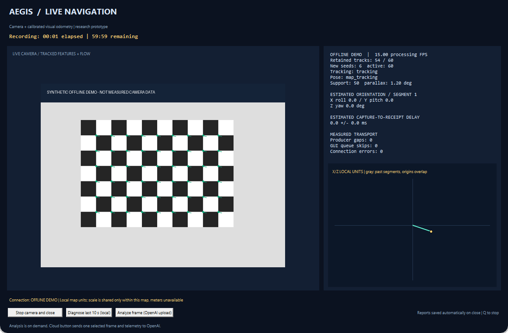
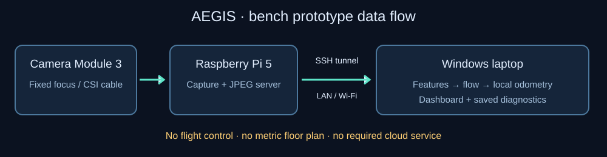

# AEGIS — Visual Navigation Proof of Concept

**A Raspberry Pi camera and a Windows laptop exploring navigation without GPS.**

AEGIS streams live video, finds and tracks visual features, estimates relative camera motion, and displays local tracking and recovery diagnostics. It is a hands-on computer vision and aerospace research prototype, developed through eight phases of implementation and controlled experiments.

The long-term idea is a visual navigation component for a drone or another mobile platform. **This version is a bench prototype: it has no flight controller integration, motor control, autonomous flight, obstacle avoidance, or flight qualification.**



*The actual dashboard interface with an explicitly synthetic scene and illustrative telemetry. This image shows the layout, not a measured trial.*

## What it can do

- Stream a Pi Camera Module 3 feed over an SSH tunnel (tested at 640 × 480, nominal 15 FPS).
- Compare Shi–Tomasi and ORB feature detection.
- Track features with pyramidal Lucas–Kanade optical flow, draw motion vectors, and replace lost features.
- Capture checkerboard views and calculate camera calibration with quality checks.
- Estimate calibrated relative motion and track a sparse local landmark map when image geometry supports it.
- Attempt bounded recovery of retained landmarks or an earlier heading after tracking loss.
- Display camera video, tracking support, estimated orientation, local paths, timing, and connection warnings.
- Save JSON reports, CSV telemetry, and optional raw recordings.
- Run local navigation diagnostics; optionally request cloud scene analysis with a separately configured API key.

## What the map means

The path plot is an estimate in **arbitrary local units**. It is not a floor plan and does not provide reliable distance, speed, GPS coordinates, or a building map. Different local maps can have independent origins and scales. The viewer keeps gaps visible rather than inventing motion through them.

Temporary rotation gaps, lost maps, and unsuccessful recovery still occur. A short line, a stationary dot, or a waiting state can mean insufficient supported motion. A live video feed does not mean a valid pose estimate exists. This project does not yet distinguish walls from furniture or produce a dense 2D/3D room map.

## Start here

1. Follow [Pi + laptop setup](docs/GETTING_STARTED.md).
2. Follow [camera calibration](docs/CALIBRATION_GUIDE.md) before odometry/dashboard use.
3. Read [how to use the displays and save recordings](docs/USER_GUIDE.md).
4. Read [final results and limitations](docs/PHASE8_RESULTS.md).

Once configured, start the dashboard from Windows PowerShell in the repository:

```powershell
.\scripts\start_stream.ps1 -Dashboard
```

For a first camera test that does not need calibration:

```powershell
.\scripts\start_stream.ps1 -Features none
```

Press **Q** or close the window to stop. The launcher closes its SSH tunnel and requests camera shutdown.

## Hardware and software

Tested hardware: Raspberry Pi 5, Raspberry Pi Camera Module 3 (IMX708), CSI cable, appropriate Pi power supply, microSD storage, and a Windows laptop on the same reachable network. No depth camera, IMU, or API subscription is required for the existing vision pipeline. A rigid camera mount and good diffuse lighting help.

Tested Pi environment: Debian 12 Bookworm, aarch64, Python 3.11, OS-provided Picamera2/libcamera. Laptop: Windows, Python 3.12, Tk, Pillow, NumPy, and OpenCV. Other combinations need their own verification. The Pi captures and encodes; the laptop runs vision and the dashboard. Pi-only operation has not been implemented.



## Validation status

Phase 8 passed the agreed **limited local-map prototype checks** using `retained-map-recovery-v10`. It did not establish continuous global navigation or independent metric accuracy. Two fresh validation recordings contained 4,988 frames; preceding software qualification covered 84 tests and 27,059 saved frames. Fresh network recovery was 1.657 seconds, and covered-view recovery was 1.797 seconds relative to the first sampled clear frame. Both occurred in a supported stationary local map. Tracking losses elsewhere remain documented.

See [the readable final assessment](docs/PHASE8_RESULTS.md), the [original detailed final report](docs/phase8_v10_final_series.md), and [research archive notes](docs/RESEARCH_ARCHIVE.md). Private raw recordings and machine-specific reports are excluded; published measurements are reported experimental results, not reproducible evidence bundled in this repository.

## Repository guide

| Directory | Purpose |
|---|---|
| `pi/` | Camera capture, MJPEG server, owned-process control |
| `laptop/` | Detectors, flow, calibration, visual odometry, dashboard, diagnostics, research probes |
| `scripts/` | Environment setup, launchers, calibration target generation |
| `configs/` | Camera/tracking settings and validation limits |
| `tests/` | Automated regression tests |
| `docs/` | User guides, diagrams, and development reports |
| `data/`, `results/` | Created locally; excluded from Git |

Files named `*_candidate.py`, `probe_*`, and rotation experiment tools preserve investigations; they are not all enabled in the default estimator. Some replay tools require the excluded private recordings. See [research archive notes](docs/RESEARCH_ARCHIVE.md).

## Future direction

Potential work includes full visual SLAM with loop closure, stronger rotation/relocalization, independent ground-truth validation, structural room mapping, onboard processing, and eventually synchronized additional sensors. A drone version would need measured performance on its target hardware, vibration and lighting tests, flight controller integration, and carefully staged validation. None of these future capabilities is claimed by this release.

## Development and contribution

```powershell
.\.venv\Scripts\python.exe -m unittest discover -s tests -v
```

Use synthetic or consented imagery for contributions. Do not commit API keys, SSH keys, personal indoor recordings, or device-specific environment reports. This project was developed with AI coding assistance and iterative physical experiments; experimental limitations are retained rather than hidden.

## License

No license has been selected. Public visibility alone does not grant an open-source license. Dependency licenses remain with their respective owners.
