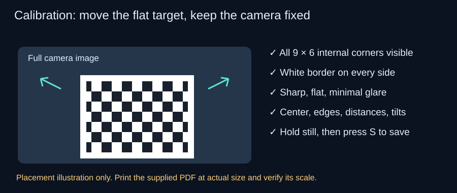

# Calibrate your own camera

Do this before odometry or the dashboard. Calibration belongs to a particular lens, image size, crop and focus setting; another camera's file should not be treated as valid for yours. This public release excludes the original camera's private calibration dataset and reviewed result.

The supplied profile uses 640 × 480, manual focus and lens position 2.0 in `configs/stream.json`. Establish that the checkerboard looks sharp at your working distances before capturing. Changing focus or camera geometry requires a new calibration. When you edit the camera configuration on the laptop, copy the same file to the Pi:

```powershell
scp configs/stream.json aegis-pi:~/AEGIS/configs/stream.json
```

## Print and capture

Print [the supplied Letter landscape checkerboard PDF](assets/checkerboard-letter.pdf) at **100% / Actual size**, without Fit to page. It has 10 × 7 squares and 9 × 6 internal corners. Measure five square widths: nominally 100 mm. Use your measured square size (five-width measurement divided by five) in the fit command. Mount it flat on rigid backing, avoid glare, and preserve the white border.



Keep the camera fixed while moving the target for calibration. From Windows PowerShell:

```powershell
.\scripts\start_calibration.ps1 -Dataset data/calibration/my-camera
```

Press **S** to save a view that passes the checks, **Q** to close. Captures are deliberate; there is no automatic timed sequence. Aim for 25 diverse views, including center, all sides/corners, near/far distances and tilts with each edge closer. Keep the entire pattern and border in frame, make the pattern large enough to detect, and hold steady. Start roughly 12–36 inches away as visibility permits; these are examples, not required distances. Do not move or refocus the camera during this dataset.

The tool rejects insufficient pattern visibility, blur, small boards and near-duplicate views. A saved image is not yet a completed calibration. Resume with:

```powershell
.\scripts\start_calibration.ps1 -Dataset data/calibration/my-camera -Resume
```

## Calculate and review

For verified 20 mm squares:

```powershell
.\.venv\Scripts\python.exe -m laptop.camera_calibration fit --dataset data/calibration/my-camera --output results/calibration/my-camera.json --square-mm 20
```

Inspect `training_rms_px`, `heldout_mean_rms_px`, `numerical_checks_passed`, and `warnings` in the output. The tool reports numerical and held-out checks; small reprojection error does not prove navigation accuracy. Examine an undistortion comparison:

```powershell
.\.venv\Scripts\python.exe -m laptop.camera_calibration preview --dataset data/calibration/my-camera --calibration results/calibration/my-camera.json --view view-0001.png --output results/calibration/my-preview.png
```

Use another saved view name if needed. Check straight structures and corner placement, investigate warnings, and recapture a more diverse dataset if checks fail. Outputs refuse overwrite: choose a fresh output filename on repeated fits/previews.

After review, launch explicitly with your result:

```powershell
.\scripts\start_stream.ps1 -Dashboard -OdometryCalibration results/calibration/my-camera.json
```

Alternatively copy an accepted result to `results/calibration/phase4-reviewed-camera.json`, the launcher's historical default filename. That name alone does not certify the file. The runtime checks the camera profile; do not bypass a mismatch by editing the calibration JSON.
