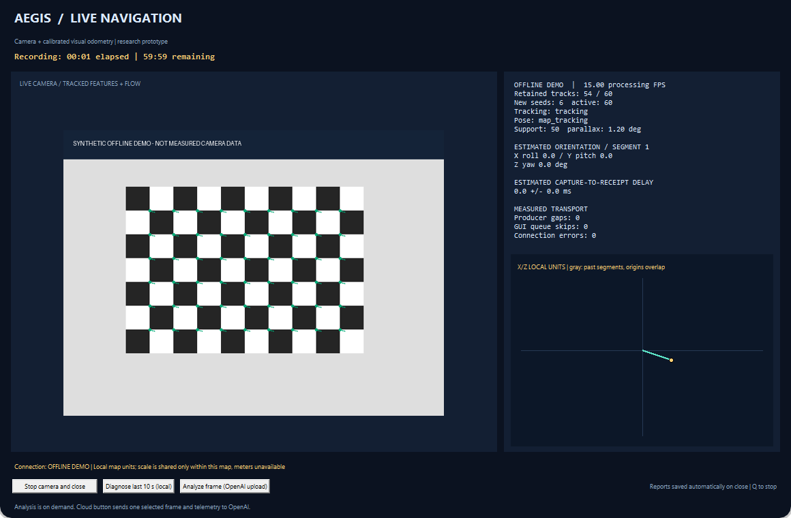

# Use AEGIS

All commands below run in Windows PowerShell from the repository, after setup. The Pi must be powered and reachable through `ssh aegis-pi`.

## Modes

To inspect the dashboard without hardware, run `.\.venv\Scripts\python.exe scripts/demo_dashboard.py`. It uses a synthetic scene and illustrative telemetry, performs no navigation or network access, and is separate from the camera modes below.

```powershell
# Video only; no calibration required
.\scripts\start_stream.ps1 -Features none

# Feature detector comparison
.\scripts\start_stream.ps1 -Features both

# Optical flow tracks and vectors; no calibration required
.\scripts\start_stream.ps1 -Tracking

# Calibrated odometry and full dashboard
.\scripts\start_stream.ps1 -Dashboard -OdometryCalibration results/calibration/my-camera.json

# Timed dashboard with raw images, telemetry and reports
.\scripts\start_stream.ps1 -Dashboard -OdometryCalibration results/calibration/my-camera.json -DurationSeconds 120 -RecordingDirectory data/recordings/desk-trial-01 -Experiment desk-trial-01
```

Use a fresh recording directory for each run. Reports go to `results/reports/`; raw images can consume significant storage and may show private surroundings. They are excluded from Git by default. Stop using **Q**, the close control, or **Stop camera and close**. Allow the launcher to finish cleanup and writing reports.

## Read the dashboard



This is an actual application window populated with synthetic demonstration input. Counts, motion and timings in this example are illustrative, not measured performance.

- **Camera panel:** features and flow vectors; vectors are enlarged for visibility.
- **Processing FPS:** recent processing throughput, distinct from requested camera FPS.
- **Retained tracks/new seeds:** continuing observations versus replacement points. Lots of dots alone do not establish a valid motion estimate.
- **Pose:** `map_tracking` indicates supported local-map pose; waiting/rejected/reset states indicate unavailable new motion. `rotation_only` gives orientation with unknown translation. Recovery does not reconstruct unseen motion.
- **Orientation:** estimated relative orientation in the current heading reference, not a compass or true north.
- **Path:** X/Z local units with segment breaks. It is not a floor plan. A new origin can overlap an older origin in the drawing; that does not align separate maps.
- **Timing and transport:** estimated capture-to-receipt delay, clock uncertainty, sequence gaps, GUI skips and connection errors. These are separate counters; they do not measure flight responsiveness.
- **STALE:** the last displayed frame/estimate is historical, not current observation.

## A first motion experiment

Use a stationary, well-lit scene with textured objects at several distances. Begin still, then translate the camera slowly sideways a few centimeters while keeping its direction steady. Avoid pointing only at a blank wall or a repetitive checkerboard. Hold at the end and slowly return. Rotation alone often cannot initialize a translation map, and abrupt motion can lose tracks.

When tracking fails, return to a previously observed view and hold still. A supported retained map may recover; otherwise the estimator waits or starts a distinct local map. It cannot promise continuous tracking or safe obstacle clearance.

## Diagnostics and optional AI

**Diagnose last 10 s (local)** creates a local evidence summary and needs no API key. **Analyze frame (OpenAI upload)** sends selected telemetry and an image to a cloud service, requires your own API key/model and API credits, and may incur charges. It is on demand; AI output does not control navigation.

To enable cloud analysis, run `scripts/configure_ai_key.ps1` to enter a key through hidden input. It stores a Windows user environment variable outside the repository. Set `AEGIS_AI_MODEL` to a model available in your account; the project does not select one automatically. Do not paste keys into source, screenshots or issue reports. Core vision remains usable without cloud configuration. The API request uses `store=false`; that is not a guarantee of zero provider retention.

## Desktop shortcut

On Windows Desktop choose **New → Shortcut**. Use the full path to the launcher in this target, replacing the example repository path:

```text
powershell.exe -NoProfile -ExecutionPolicy Bypass -NoExit -File "C:\Projects\AEGIS\scripts\start_stream.ps1" -Dashboard -OdometryCalibration "results/calibration/my-camera.json"
```

Name it AEGIS. The launcher sets its own working directory. Keep the console open until normal cleanup finishes. To stop work for the day, close the viewer first, then shut down the Pi with `ssh aegis-pi 'sudo shutdown -h now'` and wait for shutdown before removing power.
