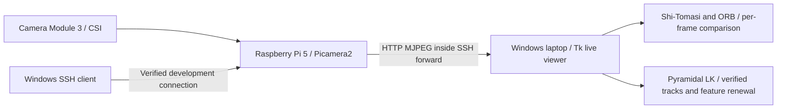

# Architecture and phase boundaries

The Pi owns camera capture and OS-managed camera drivers. Windows will own
calibration, tracking, motion estimation, and visualization in later phases.
HTTP/MJPEG is the Phase 1 video protocol. SSH carries that HTTP connection over
the existing verified remote connection; both HTTP endpoints bind to loopback.
Each machine has its own `.venv`. Pi environments inherit system packages because
Picamera2 and libcamera must match the installed OS camera stack.

Phase 0 creates only `pi/capture_test.py`, environment verification, setup helpers,
tests, and documentation. Future module directories are reserved without fake
implementations. Later tests must support recorded or synthetic inputs.

Phase 1 adds `pi/camera_server.py`, `pi/stream_control.py`, `laptop/camera_client.py`,
and `configs/stream.json`. One producer JPEG-encodes each frame once; HTTP client
threads read its latest frame. Slow HTTP readers may skip producer frames instead
of building an application queue. TCP/SSH can still buffer frames; the measured
delay reveals transport backlog. The laptop receiver decodes on a worker thread,
and Tk displays the most recent available image. Display queue skips are counted
separately from received sequence gaps. Clock probes run on a separate thread so
periodic calibration does not stall stream consumption.

Phase 2 adds laptop-only OpenCV/NumPy detectors and a saved-image benchmark.
Both detectors receive the same grayscale image; their execution order alternates.
Detector metrics are independent of transport metrics. Grid occupancy and counts
are diagnostics, not tracking or pose estimates. The Pi capture server is unchanged.

Phase 3 adds a separate stateful LK mode. It keeps one previous grayscale frame,
surviving points with stable IDs, and the previous session/frame/sensor timestamp.
Forward–backward and patch-quality checks reject unreliable candidates; current
image feature renewal supplies new IDs. Camera session changes and long capture
gaps reset tracking. All tracking runs on Windows; only camera frames and their
metadata cross the SSH transport. No pose accumulation or calibration is present.

Images and telemetry remain local. No OpenAI/Anthropic calls are implemented.
Autofocus is permitted for this connectivity test; calibration will require an
explicit repeatable focus configuration in Phase 4. The initial still capture
uses 640 by 480 pixels, which is not a streaming FPS benchmark.
